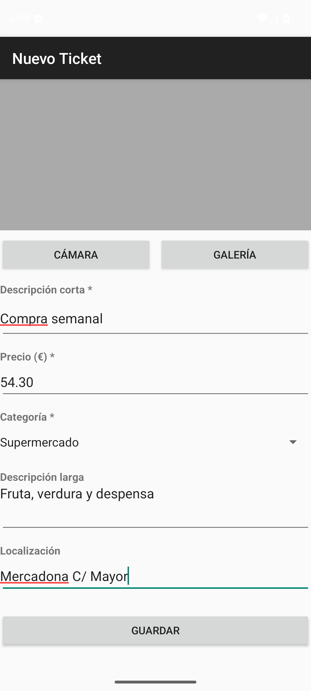
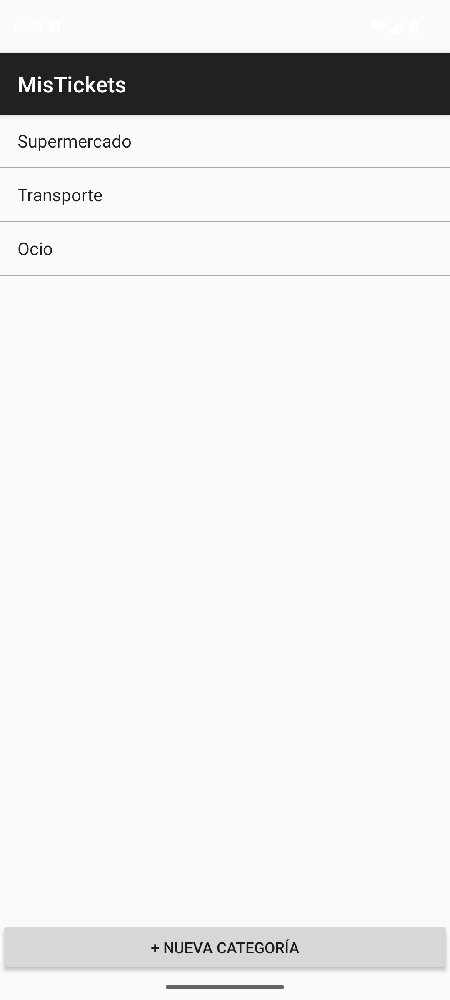
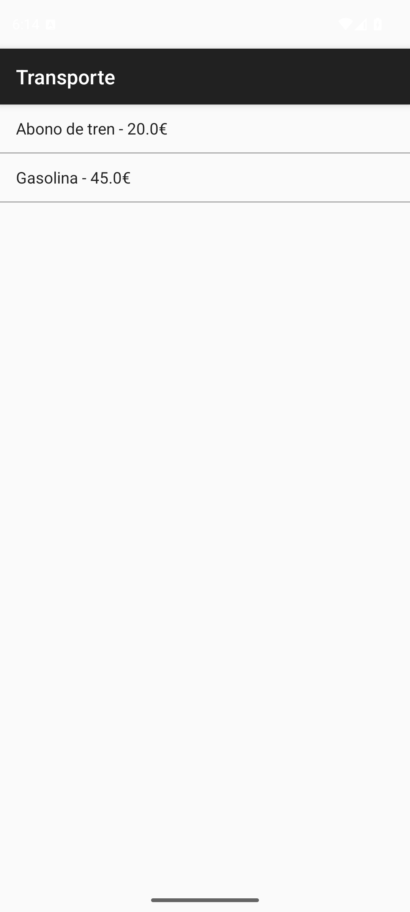
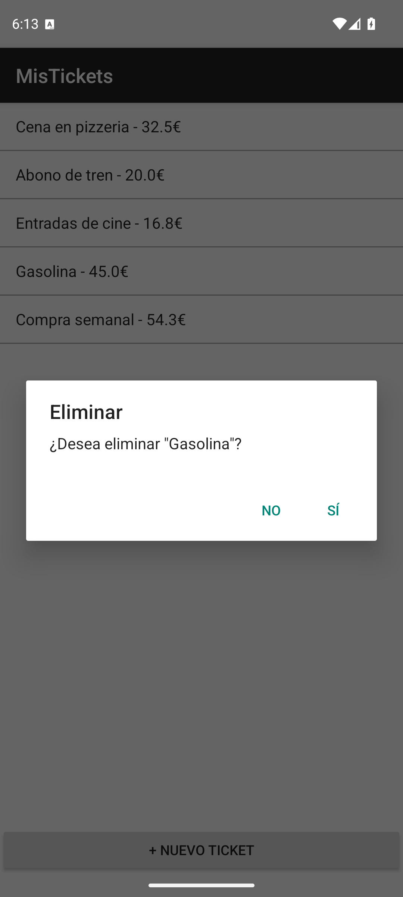

# 📱 MisTickets · Gestor de Tickets de Gasto (Android)

Aplicación Android nativa para gestionar **tickets de gasto** organizados por **categorías**. Desarrollada en **Java** con **persistencia local SQLite**. Práctica final de la asignatura *Desarrollo de Aplicaciones para Dispositivos Móviles* (UMH).

## ✨ Características

- 📝 **CRUD completo de tickets**: crear, editar, eliminar y listar gastos
- 🏷️ **Gestión de categorías**: crea categorías personalizadas para organizar tus tickets
- 🔍 **Filtrado por categoría**: visualiza solo los tickets de una categoría concreta
- 💾 **Persistencia local con SQLite**: tus datos no se pierden al cerrar la app
- 🧭 **Navegación entre Activities** con `Intent` y paso de datos

## 📸 Capturas

| Lista de tickets | Nuevo ticket | Categorías | Tickets por categoría | Confirmar borrado |
|:---:|:---:|:---:|:---:|:---:|
|  |  |  |  |  |

## 🏗️ Arquitectura

```
app/src/main/java/es/umh/dadm/mistickets/
├── MainActivity.java                  ← pantalla principal con botones de navegación
├── ListaTicketsActivity.java          ← muestra el listado completo de tickets
├── ListaCategoriasActivity.java       ← muestra el listado de categorías
├── TicketsPorCategoriaActivity.java   ← filtra tickets por categoría
├── FormularioTicketActivity.java      ← crea/edita un ticket
├── FormularioCategoriaActivity.java   ← crea/edita una categoría
├── Ticket.java                        ← modelo (POJO) de un ticket
├── Categoria.java                     ← modelo (POJO) de una categoría
├── TicketsSQLiteHelper.java           ← helper SQLite para la tabla TICKETS
└── CategoriasHelper.java              ← helper SQLite para la tabla CATEGORIAS
```

## 🛠️ Tecnologías


## 🎯 Conceptos aplicados

- **Ciclo de vida de Activities** (`onCreate`, `onResume`, etc.)
- **Persistencia con SQLite** mediante `SQLiteOpenHelper`
- **Patrón DAO** (separación entre modelo y acceso a datos)
- **Navegación entre Activities** con `Intent`s explícitos
- **Paso de datos** entre pantallas (`putExtra` / `getExtras`)
- **Diseño de UI** con layouts XML y recursos en `res/`
- **Adapters personalizados** para `ListView`/`RecyclerView`
- Resultados con `startActivityForResult` / `onActivityResult`

## 🚀 Cómo ejecutar

1. Clonar el repositorio:
   ```bash
   git clone https://github.com/JavierCresp0/mis-tickets-android.git
   ```
2. Abrir el proyecto con **Android Studio**
3. Esperar a que Gradle sincronice las dependencias
4. Conectar un dispositivo Android o lanzar un emulador
5. Pulsar **Run ▶️** o `Shift + F10`

## 📋 Requisitos

- **Android Studio** Hedgehog (2023.1.1) o superior
- **JDK 11+**
- **SDK Android** API 24+

## 🔀 La misma idea en Flutter y React Native

En la siguiente práctica de la asignatura rehice una versión reducida de la app con dos frameworks multiplataforma, para comparar cómo se resuelve lo mismo en cada uno. Están en [`multiplataforma/`](multiplataforma/):

| | Flutter | React Native (Expo) |
|---|---|---|
| Carpeta | [`multiplataforma/flutter`](multiplataforma/flutter) | [`multiplataforma/react-native`](multiplataforma/react-native) |
| Lenguaje | Dart | JavaScript |
| Pantallas | Alta de ticket · listado | Alta de ticket · cámara · listado |
| Foto del ticket | `image_picker` (cámara y galería) | `expo-camera` y `expo-image-picker` |
| Guardado | `tickets.json` con `path_provider` | `tickets.json` con `expo-file-system` |
| Navegación | `Navigator.push` | React Navigation (*native stack*) |

Las dos hacen lo mismo: fotografiar o elegir la imagen de un ticket, añadirle descripción y categoría, guardarlo en un fichero JSON del dispositivo y mostrar el listado. A diferencia de la app nativa, no usan SQLite ni permiten editar.

```bash
# Flutter (las carpetas de iOS, web y escritorio se regeneran con el primer comando)
cd multiplataforma/flutter
flutter create .
flutter run

# React Native
cd multiplataforma/react-native
npm install
npx expo start
```

La [memoria de la práctica](multiplataforma/Memoria.pdf) recoge los problemas encontrados y la comparación entre ambos.

---

📌 *Práctica final de la asignatura Desarrollo de Aplicaciones para Dispositivos Móviles (DADM) — Universidad Miguel Hernández.*
